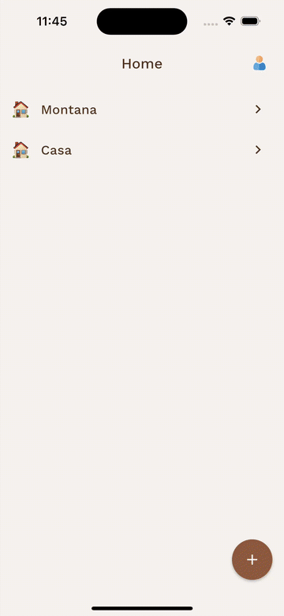
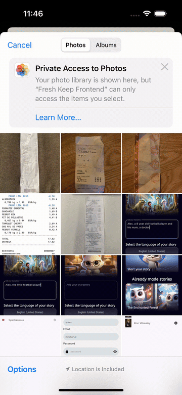
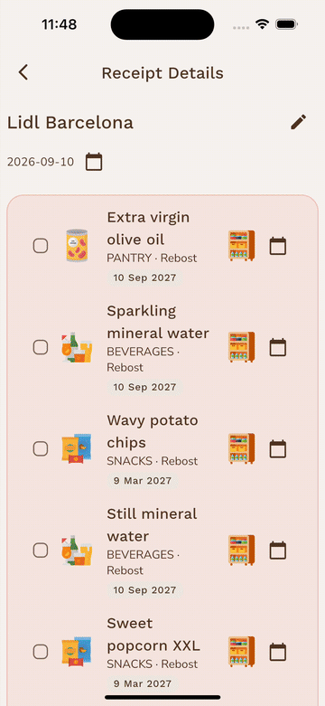
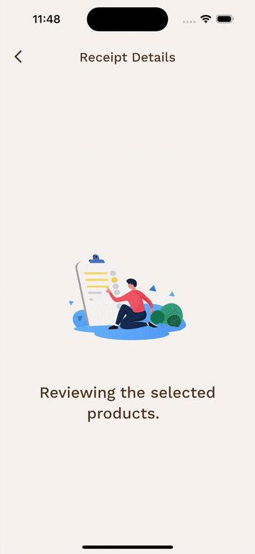

# 🥬 Fresh Keep

````
Keep you products fresh.
Keep track of what food you have, where it's stored, and how long you can keep it.
````

| Space View | Shopping Receipt Selection | Processing Result |
| :---: | :---: | :---: |
|  |  |  |

| Reprocessing Selection | Final List |
| :---: | :---: |
|  |  |

---

## Table of contents

- [🥬 Fresh Keep](#-fresh-keep)
  - [Table of contents](#table-of-contents)
  - [🥦 What is Fresh Keep?](#-what-is-fresh-keep)
  - [💸 Start cutting down on food waste!](#-start-cutting-down-on-food-waste)
    - [1. Create an account and log in](#1-create-an-account-and-log-in)
    - [2. Create your first space](#2-create-your-first-space)
    - [3. Add food from a shopping receipt](#3-add-food-from-a-shopping-receipt)
    - [4. Keep track of what's in a space](#4-keep-track-of-whats-in-a-space)
    - [5. Share a space with others](#5-share-a-space-with-others)
  - [✨ Features](#-features)
    - [Authentication](#authentication)
    - [Spaces \& storage spots](#spaces--storage-spots)
    - [Shopping receipt processing](#shopping-receipt-processing)
    - [Space overview \& product management](#space-overview--product-management)
  - [🛠️ Tech stack](#️-tech-stack)
  - [🚀 Getting started](#-getting-started)
    - [Prerequisites](#prerequisites)
    - [Install and run](#install-and-run)
    - [Supported platforms](#supported-platforms)
  - [⚙️ Configuration](#️-configuration)
    - [Backend URL](#backend-url)
    - [Invitation deep links](#invitation-deep-links)
    - [Permissions](#permissions)
  - [🌳 Project structure](#-project-structure)
  - [📐 Architecture](#-architecture)
    - [Conventions](#conventions)
  - [📍 Navigation](#-navigation)
  - [⛓ Backend API](#-backend-api)
  - [🧪 Testing](#-testing)
  - [🚧 Development workflow](#-development-workflow)
    - [Specs](#specs)
    - [Branches \& pull requests](#branches--pull-requests)

---

## 🥦 What is Fresh Keep?

Fresh Keep is an application that helps households keep track of the food they buy and when it expires.

Take a photo of a shopping receipt, let AI extract the products and estimate their expiration dates, and keep everything organized in shared **spaces** (a home, a flat, an office) and their **storage spots** (fridge, freezer, pantry…).

This repository is the cross-platform **Flutter client**. It talks to a separate Spring Boot backend over a JWT-secured REST API.

## 💸 Start cutting down on food waste!

Here is what a typical session looks like, from creating an account to managing your groceries.

### 1. Create an account and log in
1. On the **Log in** screen, tap **Don't have an account? Register**.
2. Enter your email and password, confirm the password, and tap **Register**.
3. You're taken back to **Log in**. Sign in with your new credentials.

You stay logged in the next time you open the app. To sign out, tap the account icon on **Home** and then **Log out**.

### 2. Create your first space
A *space* is a place where you keep food, like *Home* or *Office*. Each space has *storage spots*, like a fridge, a freezer or a pantry.

1. On **Home**, tap the **+** button and choose **Create a New Space**.
2. Give it a **Space Name** and pick an emoji.
3. Add its storage spots. For each one, choose a type and a name. Tap **Add Another Storage Spot** to add more.
4. Tap **Create**, then **OK**. The space now appears on **Home**.

### 3. Add food from a shopping receipt
1. On **Home**, tap **+** and choose **Process a New Receipt**.
2. On **Select a Space**, pick the space the groceries go to.
3. Choose a photo of the receipt from your gallery. Check it and tap the ✓ (**OK**) button. Tap back to pick another photo.
4. Wait while the AI reads the receipt.
5. Review the **Receipt Details**:
   - Products the AI wasn't sure about are highlighted at the top.
   - Use the pencil and calendar icons to fix the **store name**, the **shopping date** or any product's **expiration date**.
6. Choose what to do next:
   - Tap **OK** to save the products to the space.
   - Or tick the products that look wrong and tap **Reprocess selected products** so the AI reads them again. Then review the new results and tap **OK**.

When you're done, you land on the space overview with your new products.

### 4. Keep track of what's in a space
Tap a space on **Home** to open its overview. Products are sorted by expiration date, so whatever expires first is at the top.

- **Filter** by storage spot with the chips at the top (**All**, *Fridge*, *Pantry*…).
- **Search** products with the 🔍 icon.
- **Select** products with a long press. Once selection mode is on, tap other products to add them. Then use the buttons at the top:
  - ✏️ **Edit** (one product): change its name, expiration date, type, amount or currency, then tap **Save**.
  - 📁 **Move** (one product): pick any storage spot in any of your spaces. The expiration date is recalculated for the new spot.
  - 🗑️ **Delete selected**: remove one or more products, for example once you've eaten them.

### 5. Share a space with others
1. In a space's overview, tap the **Invite** icon (👤+).
2. **Copy** the invitation link or **Share** it through any messaging app.
3. The person you invite opens the link on their phone. Fresh Keep opens and shows the invitation. They tap **Join** and the space appears on their **Home**. If they aren't logged in yet, they log in first and the invitation shows up right after.

Everyone in the space sees the same products, so the whole household stays up to date.

## ✨ Features

### Authentication
- User registration and login against the backend's JWT auth endpoints.
- The token is stored in secure storage (`flutter_secure_storage`) and attached as `Authorization: Bearer <token>` to every request.
- Session restore on startup (splash screen), logout, and an account page.

### Spaces & storage spots
- Create a space with a name, an emoji and any number of storage spots (fridge, freezer, pantry, shelf, wine cellar…).
- See all the spaces you take part in on the home screen.
- **Invite others:** generate an invitation link (`freshkeep://join?token=…`) and share it with the native share sheet.
- **Join from a link:** opening an invitation link launches the app on the join screen. If you aren't logged in yet, the invitation is kept and resumed right after login.

### Shopping receipt processing
1. Pick a space, then a receipt photo from the device's photo library.
2. Confirm the image and upload it. The backend extracts the store name, shopping date and products with AI.
3. Review the results. Products the AI is unsure about are flagged and shown first.
4. Before confirming you can edit the shopping date, the store name and each product's expiration date. Expiration dates you didn't edit move by the same number of days as the shopping date.
5. **Confirm** to save the receipt, or select products and **reprocess** them with AI.
6. If something fails, you get a specific error message for each case (invalid image, rate limit, server error, no connection…).

### Space overview & product management
- Per-space overview listing every product, sorted by expiration date, with expiration badges and product-type icons.
- **Edit** a product's data.
- **Move** a product to any storage spot of any of your spaces. The backend recalculates its expiration date.
- **Delete** one or several products using selection mode.

---

## 🛠️ Tech stack

| Concern | Library |
|---|---|
| Framework | Flutter (Dart SDK `^3.9.2`), Material Design |
| State management | [`flutter_bloc`](https://pub.dev/packages/flutter_bloc) (BLoC + Cubit) |
| Navigation | [`go_router`](https://pub.dev/packages/go_router) |
| Dependency injection | [`get_it`](https://pub.dev/packages/get_it) |
| Networking | [`dio`](https://pub.dev/packages/dio) |
| Functional error handling | [`fpdart`](https://pub.dev/packages/fpdart) (`Either<Failure, T>`) |
| Value equality | [`equatable`](https://pub.dev/packages/equatable) |
| Secure token storage | [`flutter_secure_storage`](https://pub.dev/packages/flutter_secure_storage), [`jwt_decoder`](https://pub.dev/packages/jwt_decoder) |
| Deep links | [`app_links`](https://pub.dev/packages/app_links) |
| Media & sharing | [`image_picker`](https://pub.dev/packages/image_picker), [`share_plus`](https://pub.dev/packages/share_plus), [`emoji_picker_flutter`](https://pub.dev/packages/emoji_picker_flutter) |
| Animations | [`lottie`](https://pub.dev/packages/lottie) |
| Fonts | Work Sans, Nunito Sans (bundled in `assets/fonts/`) |

---

## 🚀 Getting started

### Prerequisites

- [Flutter](https://docs.flutter.dev/get-started/install) with a Dart SDK compatible with `^3.9.2`. [FVM](https://fvm.app/) is optional. If you use it, prefix the commands below with `fvm`.
- A running instance of the **Fresh Keep backend** (Spring Boot). By default the app expects it at `http://localhost:8082`.
- Platform toolchains for your target: Android Studio / Android SDK, Xcode (iOS/macOS), or Chrome (web).

### Install and run

```bash
git clone https://github.com/isalvama/FreshKeep_frontend.git
cd FreshKeep_frontend

flutter pub get
flutter run
```

To point the app at a different backend, see [Configuration](#configuration).

### Supported platforms

Android, iOS, web, macOS, Linux and Windows. All platform folders were generated by `flutter create`. Android and iOS are the main targets: photo picking, sharing and invitation deep links are set up there.

---

## ⚙️ Configuration

### Backend URL

The base URL is read at compile time from the `API_BASE_URL` define (`lib/core/config/env.dart`):

```bash
flutter run --dart-define=API_BASE_URL=http://localhost:8082
```

| Target | Typical value |
|---|---|
| iOS simulator, desktop, web | `http://localhost:8082` (default) |
| Android emulator | `http://10.0.2.2:8082` (the emulator's alias for the host machine) |
| Physical device | `http://<your-computer-LAN-IP>:8082` |

The same flag works with `flutter build`:

```bash
flutter build apk --dart-define=API_BASE_URL=https://api.example.com
```

### Invitation deep links

Invitations use the custom URL scheme `freshkeep://join?token=<token>`, defined in `lib/core/constants/invitation_constants.dart`:

- **Android:** an `intent-filter` for scheme `freshkeep`, host `join` in `android/app/src/main/AndroidManifest.xml`.
- **iOS:** `CFBundleURLTypes` in `ios/Runner/Info.plist`.

To test on an Android emulator:

```bash
adb shell am start -a android.intent.action.VIEW -d "freshkeep://join?token=YOUR_TOKEN"
```

On an iOS simulator:

```bash
xcrun simctl openurl booted "freshkeep://join?token=YOUR_TOKEN"
```

### Permissions

- **iOS:** `NSPhotoLibraryUsageDescription` is used to pick receipt photos.
- **Android:** `INTERNET`.

---

## 🌳 Project structure

```
lib/
├── main.dart                 # Entry point
├── app.dart                  # Root widget: theme, router, app-wide BLoC providers
├── core/
│   ├── config/               # Environment (API_BASE_URL)
│   ├── constants/            # Storage keys, UI constants, invitation link helpers
│   ├── deep_links/           # Invitation link listener + pending-invitation store
│   ├── di/                   # get_it service locator
│   ├── errors/               # Sealed Failure hierarchies per feature
│   ├── network/              # Dio client with JWT interceptor
│   └── theme/                # Colors and Material theme
├── features/
│   ├── auth/                 # Register, login, session, account
│   ├── spaces/               # Spaces, storage spots, invitations, join
│   ├── shopping_receipt/     # Receipt upload, AI extraction review, confirm/reprocess
│   ├── space_overview/       # Per-space product overview
│   └── products/             # Edit, move and delete products
├── resources/                # Asset path registry
├── routes/                   # GoRouter configuration and auth redirects
└── shared/widgets/           # Reusable widgets (badges, icons, loading animation)

assets/
├── animations/               # Lottie JSON animations
├── fonts/                    # Work Sans, Nunito Sans
└── images/                   # Product-type and storage-spot illustrations

specs/                        # Feature specifications (one per implemented feature)
test/                         # Unit, BLoC and widget tests, mirroring lib/
```

Each feature folder has the same three layers:

```
features/<feature>/
├── domain/        # entities/, repositories/ (interfaces), usecases/
├── data/          # datasources/, models/ (DTOs), repositories/ (implementations)
└── presentation/  # bloc/, pages/, widgets/
```

---

## 📐 Architecture

The app follows **Clean Architecture** with strictly separated layers:

- **Domain** (core): plain Dart entities, repository interfaces and use cases. It depends on no other layer and no Flutter or networking code.
- **Data:** remote data sources (Dio), DTO models with `toEntity()` / `fromEntity()`, and repository implementations. These turn `DioException`s into typed `Failure`s and return `Either<Failure, T>`.
- **Presentation:** pages and widgets that only dispatch events and render state, plus BLoCs that call use cases.

```
Widget ──event──▶ BLoC ──▶ UseCase ──▶ Repository (interface)
   ▲                                          │
   └──────state────────── Either<Failure,T> ◀─┘
                                     RepositoryImpl ──▶ RemoteDataSource ──▶ Dio ──▶ Backend
```

### Conventions

- **BLoC first.** BLoC is used for anything with API calls, side effects or several state transitions. Cubit is only for simple local UI state.
- **Event names are in the past tense**, e.g. `LoginSubmitted`, `SpaceOverviewRequested`.
- **States are immutable** and use `equatable`.
- **Dependency injection** goes through `get_it` (`lib/core/di/service_locator.dart`). App-wide BLoCs (auth, spaces, shopping receipt) are singletons. Screen-scoped BLoCs (space overview, edit product, join space) are factories created in the route builder.
- **Errors** are modelled as sealed `Failure` classes per feature (`lib/core/errors/failures.dart`). Each one carries a message the user can read.

---

## 📍 Navigation

Routing is handled by GoRouter (`lib/routes/app_router.dart`). It re-runs its redirects whenever `AuthBloc` emits a new state:

- While auth status is unknown, the app shows `/splash`.
- Logged-out users can only reach `/login` and `/register`.
- Logged-in users who land on an auth route or the splash screen are sent to `/home`.
- A `/join?token=…` link opened while logged out is saved and resumed after login.

| Route | Screen |
|---|---|
| `/splash`, `/login`, `/register` | Startup and authentication |
| `/home`, `/account` | Spaces list, account |
| `/create-space`, `/create-space/status` | Create a space |
| `/join?token=…` | Join a space from an invitation |
| `/process-receipt/space` → `confirm-image` → `processing` → `results` / `reprocessed-results` / `error` | Receipt flow |
| `/space-overview/:spaceId` | Space overview |
| `/space-overview/:spaceId/products/:productId/edit` | Edit product |

---

## ⛓ Backend API

The backend is a separate Spring Boot service and is not part of this repository. Its contract is documented in [`api_contract.md`](api_contract.md): request and response shapes, RFC 7807 `ProblemDetail` errors and the stateless JWT security model.

Endpoints used by the client:

| Area | Endpoints |
|---|---|
| Auth | `POST /api/v1/auth/register/user`, `POST /api/v1/auth/login` |
| Spaces | `GET /api/v1/spaces`, `POST /api/v1/spaces`, `GET /api/v1/spaces/{spaceId}/overview` |
| Invitations | `POST /api/v1/spaces/{spaceId}/invitations`, `POST /api/v1/spaces/invitations/{token}/join` |
| Receipts | `POST /api/v1/spaces/{spaceId}/receipt-images`, `POST /api/v1/spaces/{spaceId}/shopping-receipt/confirm`, `POST /api/v1/spaces/{spaceId}/shopping-receipt/reprocess` |
| Products | `PATCH /api/v1/products/{id}`, `PATCH /api/v1/products/{id}/storage-spot`, `DELETE /api/v1/products/{id}`, `DELETE /api/v1/products` |

---

## 🧪 Testing

The `test/` folder mirrors `lib/` and holds repository, BLoC, widget, router and DI tests.

```bash
flutter test                                  # run all tests
flutter test test/routes/app_router_test.dart # run one file
flutter test --coverage                       # write coverage to coverage/lcov.info
```

---

## 🚧 Development workflow

```bash
flutter analyze    # static analysis (flutter_lints)
dart format .      # format code
flutter test       # run tests
```

### Specs

Every feature is planned in a numbered spec in [`specs/`](specs/) before it is built. A spec lists the scope, the data model, the API calls, the edge cases and the tests. Read the related spec before changing a feature, and write a new one for new work.

### Branches & pull requests

- `main` is the integration branch.
- Work on short-lived branches with a prefix: `feat/…`, `fix/…`, `refactor/…`, `docs/…`.
- Open a pull request into `main`. Run `flutter analyze` and `flutter test` first and make sure both pass.
